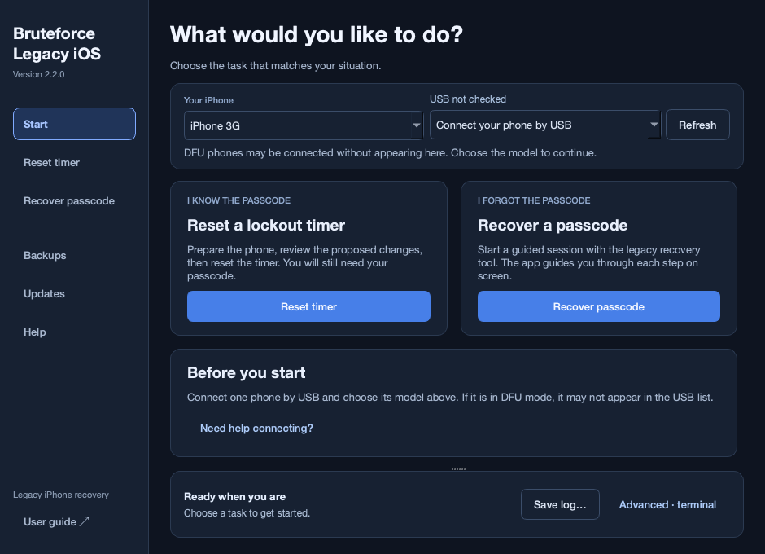

# Openup

[](https://github.com/channelramble/Openup/actions/workflows/ci.yml)

A desktop app for legacy iPhone recovery, with guided timer reset, a pinned recovery backend, backups, and a built-in updater. Desktop downloads include iPhone 3G ARMv6 tools and Intel Mac support targeting macOS 12 Monterey.

Version **2.3.16** adds backup deletion with two confirmation dialogs and replaces terminal-only cancellation instructions with the GUI’s **Stop** button. It also adds a visible iPhone 4S / iPad 2 warning before Start recovery, with a clickable [checkm8-A5 setup guide](https://github.com/LukeZGD/Legacy-iOS-Kit/wiki/checkm8-a5). iPad 2 recovery is not currently supported in Openup.

Version **2.3.13** improves the iPhone 3G bootloader-verification wait after a slow recovery-console response. It also corrects the timer-reset compatibility range for iPhone 5/5c: this tool supports legacy HFS partitions, so iOS 10.3 and its APFS filesystem are excluded. See the compatibility and verification sections below for the distinction between software checks and physical phone testing.

Use **Updates → Update now** to install the latest compatible release, then restart. The interface provides on-screen steps, choices, countdowns, and result cards; the terminal and manual input remain optional Advanced controls.

**Desktop downloads include Python, Qt, SSH libraries, and their Python dependencies. No Python, pip, virtual environment, or package installation is needed to open the app.** The Windows archive also includes the Linux Python/SSH runtime used by its WSL bridge.



## Download and open

Get the platform archive from [version 2.3.16](https://github.com/channelramble/Openup/releases/tag/v2.3.16) and extract it completely.

**Already using Openup 2.3.0–2.3.4?** Open **Updates → Check and download directly in the app → Check for updates → Install update**, then restart. Leave the token empty and Include prereleases enabled. This installs the new one-click updater without visiting GitHub.

On Intel Macs the timer reset could fail to grab the iPhone: Apple's device-handling agents claimed it before the tool could. Version 2.3.8 holds Openup's device-agent reservation across the entire timer operation — the ramdisk boot and the ramdisk SSH session — so the phone stays claimed, and restores those agents exactly as they were when it finishes. This matches what the recovery flow already did.

The timer-reset preparation used to drop into Legacy iOS Kit's SSH Ramdisk Menu and ask you to "Select an option" and choose Exit before the reset resumed. Version 2.3.7 boots the ramdisk and returns automatically, so the whole timer workflow — Prepare, Review & reset, Done — is handled by the GUI. The phone is left in the ramdisk exactly as before, and the menu still works when the kit is run outside Openup.

The 3G display wrapper could buffer progress for minutes and then print it in a burst. Version 2.3.6 makes native console output immediate while keeping the final passcode at the bottom. This display fix has passed host tests; physical validation remains pending. Custom payloads and other models are unchanged.

Version 2.3.5 also fixes the false **Upstream backend stopped with status 1** after a completed recovery handoff: a terminal-color reset was replacing the script's result in GUI mode. Actual boot errors still stop the workflow; the final passcode or any on-device error must still be read on the phone.

**Upgrading from 2.2.x:** extract and open the new `Openup` app once. The older updater expects the previous package name and cannot install this renamed layout. Openup preserves the existing backup/cache directory and recognizes older installed versions for rollback. Later Openup releases use the built-in updater normally. An older update selection cannot silently replace a freshly opened, newer app.

| Computer | Download suffix | Open |
|---|---|---|
| Intel Mac, macOS 12 Monterey+ | `macos-x86_64.zip` | `Openup.app` |
| Apple Silicon Mac, macOS 14+ | `macos-arm64.zip` | `Openup.app` |
| Windows x64 | `windows-x86_64.zip` | `Openup.exe` |
| Linux x64 desktop, Ubuntu 22.04+ or equivalent | `linux-x86_64.zip` | `Openup` |

Keep the extracted Windows/Linux folder together; it contains the bundled runtime. The Mac `.app` can be moved to Applications. These downloads are not Developer ID notarized or Windows Authenticode signed, so operating-system download protection may require an explicit open action.

Both Mac builds include Python 3.13.16 and Qt/PySide6 6.9.3. The Intel build uses cryptography 48.0.1; the other platforms use 50.0.2. Each Mac build checks every native binary's architecture, minimum macOS version, and library dependencies before signing. Earlier Intel builds were exercised under Rosetta on macOS 27; execution on an Intel Mac running Monterey is still untested. [Qt 6.9 platform support](https://doc.qt.io/archives/qt-6.9/supported-platforms.html), [cryptography 48.0.1 distributions](https://pypi.org/project/cryptography/48.0.1/#files).

USB access still depends on the host: macOS's usbmuxd service, Apple Mobile Device Service on Windows, or usbmuxd/USB permissions on Linux. Windows ramdisk backends use WSL 2 and usbipd-win. The external recovery backends may request their own system tools or elevated access. The iPhone 3G ARMv6 executables are included; drivers, WSL, firmware downloads, and backend host tools remain separate requirements.

## Use the GUI

1. **Choose your phone:** use the shared model and USB controls at the top. A phone in DFU may still be connected even when the USB list is empty.
2. **Choose a task on Start:** if you know the passcode but the phone is locked out, choose timer reset. If you forgot the passcode, choose passcode recovery.
3. **Timer reset:** follow **Prepare → Review & reset → Done**. Preparation boots the temporary ramdisk and inspects the phone. The pinned backend returns automatically after ramdisk preparation. Review the proposed changes in the result card, then confirm the reset. If the phone is already prepared, use the inspection shortcut. Changing the selected phone or its settings requires a fresh review. After reboot, use the existing passcode.
4. **Passcode recovery:** click **Start recovery** once; the app downloads the backend when needed. Follow the GUI's DFU steps and countdown. Recovery runs automatically on the iPhone, with the full passcode shown at the end of its output. There is no Show Passcode menu or terminal choice. The app finishes with **Check your iPhone**; sending the recovery system does not confirm a recovered passcode. A temporary masked GUI field still handles any required host password.
5. **Advanced options:** expand these only when needed, such as for a local 3G IPSW, a custom tools folder, or connection settings. The normal workflow uses the included tools and default settings.
6. **Backups and updates:** use Backups to restore original files, finish interrupted cleanup, or delete a selected backup. Deletion requires two confirmations and permanently removes that saved local copy; it does not change the phone. Choose **Updates → Update now** to check, download, verify and install the latest release for your computer. Choose **Restart** when ready to use it. No browser, token, file selection or GitHub CLI is required. Prereleases are included by default because Openup currently publishes prereleases. **Advanced update options** contains rollback, a local ZIP/checksum installer, release notes and an optional token kept only in memory. Updates run when requested; the app never restarts during an operation.

The **session card** displays the current step, requests a response when needed, and shows the result. The terminal stays closed even on failure. Open **Advanced · terminal** to inspect raw output; **Enable manual input** is a separate opt-in. Closing the terminal disables manual input again. Phone and settings controls are locked while an operation runs.

The 3G button helper uses elapsed-time deadlines, so a slow or missing USB response does not stretch each second. During passcode recovery on macOS, the app temporarily pauses the current user’s Apple device-handling agents and restores those same processes on exit or interruption. This prevents competing automatic device handling during USB entry.

Long operations run outside the GUI process. **Stop** requests a graceful stop; file-writing workflows ask before interruption and retain the engine's rollback behavior. Output stays in memory unless you choose **Save log**. Prompt responses are not added to the transcript by the app; backend-reported passcodes and other backend output can still appear in an export. Exports retain up to 16 MiB independently of the display's 2,500-line scrollback. If that limit is reached, the export preserves initial context and recent output with an explicit omission marker. Clearing the terminal clears both the display and export transcript. The window remains open while an operation or cleanup is active.

Desktop updates verify the GitHub asset digest, platform, clean source revision, archive paths, and all packaged file checksums. They stage a complete replacement runtime, then switch versions. The optional local installer requires a desktop ZIP and matching SHA-256 file from this repository’s release page; a locally supplied checksum checks integrity, not publisher identity. The original launcher remains your entry point; rollback selects the previous installation. Downloading a newer app does not replace an already-open window: check the running version in the title bar and restart after installing. A damaged update falls back to the original app's recovery UI.

**Validation scope:** a diagnostic iPhone 3G ramdisk, authenticated SSH and SFTP have been verified on the connected phone through an Apple Silicon MacBook. Passcode recovery and on-screen timer clearance were not run in that test. Intel USB recovery, native Windows execution and Windows USB passthrough remain unverified. The bundled ARMv6 tools also pass architecture, signature, reproducibility and actual ramdisk-library import checks. See `VERIFICATION.txt`.

The `reset` workflow still requires the correct passcode afterward. The separate `recover` command runs the externally downloaded recovery backend. Activation Lock removal and setup.app removal are outside this app's scope.

## Source edition and CLI

The unqualified `Openup-2.3.16.zip` is the source archive for development and existing CLI users. It is different from the platform desktop downloads above. The following commands apply to that source edition.

Download the ZIP from [Releases](https://github.com/channelramble/Openup/releases) and extract the whole folder onto the computer connected to the phone. Python 3.9 or newer is required.

| Host | Launcher | USB SSH / timer reset | Ramdisk preparation and recovery backend |
|---|---|---|---|
| macOS | `Launch.command` | Native usbmuxd | Native Bash tools |
| Linux | `bash Launch.sh` | Native usbmuxd | Native Linux tools; USB permissions required |
| Windows | `Launch.cmd` | Native Apple Mobile Device Service | WSL 2 Linux distribution plus usbipd-win |

Windows ramdisk operations are **not a native Win32 port** of the upstream Unix binaries. Install WSL 2, Python 3.9+, `python3-venv`, Git, Bash, and usbmuxd in the distribution. Attach the phone using usbipd-win before selecting `prepare` or `recover`. The app forwards these commands into WSL without shell interpolation; `--wsl-distro Ubuntu` selects a distribution. DFU transitions may require USB reattachment. [Microsoft USB passthrough guide](https://learn.microsoft.com/en-us/windows/wsl/connect-usb)

For a phone still attached to WSL, use `--wsl` on `devices`, `inspect`, `reset`, `restore`, or `finalize`. Example: `Launch.cmd restore "/home/user/backup-folder" --wsl --mount --apply`. Absolute Linux paths pass through; Windows paths are translated with `wslpath`.

On Linux, install/start usbmuxd and configure access to the USB device. Backend tools may prompt for sudo. `doctor` reports the selected host's requirements.

Double-click `Launch.command`, or open Terminal in the extracted folder:

```sh
./Launch.command
```

If the executable bit was lost during transfer:

```sh
bash Launch.command
```

First launch creates a separate virtual environment for this version under the user's state directory and downloads the pinned dependencies. Every launch checks locked versions and native imports. Runtime dependencies, backups, and downloaded backends stay outside the app folder.

## iPhone 3G on iOS 4

Select menu option **8**, or run:

```sh
./Launch.command prepare --model iPhone1,2 --apply
```

Use `bash Launch.sh` on Linux or `Launch.cmd` on Windows with the same arguments.

The 3G is `iPhone1,2` / `n82ap`. `m68ap` belongs to the original iPhone; an `iBSS.m68ap.RELEASE.dfu` error on a 3G can indicate incorrect device selection. The explicit 3G **timer-reset** route selects `n82ap` and the **3.1.3 / 7E18 boot ramdisk** used by Legacy iOS Kit. This does not downgrade the installed iOS 4 system. The reset adapter recognizes the older `/dev/disk0s1` and `/dev/disk0s2` partitions.

WTF mode can report the generic `m68ap` identity. Version 2.0.2 preserves the selected 3G profile while preparing files, then checks the actual chip and board after the shared WTF transition and before uploading 3G iBSS. The fix requires the reviewed, pinned Legacy iOS Kit script; an altered `--kit` script is rejected for this route. Original backend files remain unchanged.

If downloading the boot components fails, provide a complete local **iPhone 3G 3.1.3 / 7E18** IPSW:

```sh
./Launch.command prepare --model iPhone1,2 --ipsw "/path/iPhone1,2_3.1.3_7E18_Restore.ipsw" --apply
```

The app validates the IPSW product, build, and `iBSS.n82ap.RELEASE.dfu` entry before copying it into the backend cache. The reported logs established the wrong-board selection and download-path failures. This separate 3.1.3 timer-reset preparation route has not been physically revalidated by the 4.2.1 diagnostic boot test.

The 3G recovery route distinguishes WTF mode from ordinary DFU, waits for USB re-enumeration, and verifies the patched boot signature plus the real chip/board before sending iBSS. An already verified patched DFU state is reused. A stock DFU state asks for a fresh WTF transition. The tested chain uses 3.1.3 iBSS followed by the matching 4.2.1 iBEC, ramdisk and kernel. The app verifies the exact board and build in each bootloader console before sending the next stage. Recovery USB mode alone can also mean the installed iBoot is running. Failed transfers, commands or identity checks stop subsequent uploads.

Physical comparison found that 4.2.1 iBSS remained in DFU. The replacement 3.1.3 iBSS started, but launching the 4.2.1 kernel directly from it returned the phone to stock iBoot. Adding and verifying the 4.2.1 iBEC produced a running diagnostic ramdisk. The old OpenSSH 5.2 server also requires an RSA host-key signature removed from Paramiko 5; the app enables that signature only on its USB transport while preserving modern algorithm preference and host-key pinning. The UI reports actual boot progress without requiring the terminal.

The separate **passcode-recovery** route uses the **4.2.1 / 8C148** ramdisk and matching kernel. Its kernel patch requires the expected input hash and all seven expected byte patterns; an unexpected kernel stops preparation. The 3.1.3 timer-reset IPSW option above does not select the passcode-recovery firmware.

## Integrated passcode-recovery backend

Preview or install the pinned integration without connecting a phone:

```sh
./Launch.command recover
./Launch.command recover --install-only
```

Run it for a supported legacy iPhone:

```sh
./Launch.command recover --apply
```

The backend is downloaded directly from tuanemss at commit `4949674b318767de83eb149e57bcc543a6453d6e`. Its script hash and checkout are checked before compatibility edits are applied. The adapter fixes fallback iBSS/iBEC filenames, cross-checks chip/board IDs, rejects incompatible executables, and stops when patching or pwnDFU verification fails.

For an iPhone 3G, the app automatically supplies ARMv6 builds of `bruteforce`, `device_infos`, and `restored_external`:

```sh
./Launch.command recover --model iPhone1,2 --apply
```

The tools were built from [iphone-dataprotection](https://github.com/nabla-c0d3/iphone-dataprotection/tree/572dd5cd8c07f5f14f7ea9488041031dd22a26bb) at commit `572dd5cd8c07f5f14f7ea9488041031dd22a26bb`, using the iPhoneOS 4.2 SDK with an iOS 4.0 deployment target. Their bundled ZIP preserves the SHA-1 and SHA-256 signatures needed by the legacy executables; the app verifies hashes and extracts them into a private temporary directory for each operation. No separate tools folder is required.

Two builds produced identical executables, and all three tools' imports were checked against the actual 4.2.1 ramdisk. Physical recovery remains untested. The source, build recipe, provenance, and license notices are included in the release; see [THIRD_PARTY.md](THIRD_PARTY.md).

An explicit folder remains available for developers testing alternative ARMv6 builds:

```sh
./Launch.command recover --model iPhone1,2 --armv6-tools "/path/armv6-tools" --apply
```

The app continues to reject the upstream ARMv7 executables for an ARMv6 3G. The 3G timer-reset command above is available independently.

The upstream backend runs its own firmware and on-device recovery workflow. The transaction backups and rollback described below apply to this app's `reset` operation, not to upstream ramdisk tools. Backend prompts remain interactive. Connect one phone for preparation.

## CLI updater

Use menu option **9**, or:

```sh
./Launch.command update --prerelease
./Launch.command update --prerelease --apply
./Launch.command update --rollback
```

The first command checks, the second installs, and the third selects the previous installation. Omit `--prerelease` to accept stable releases only. CLI and desktop updates are separate: download a platform desktop archive once to switch to the GUI.

The source-edition updater uses [GitHub CLI](https://cli.github.com/). Run `gh auth login` if required by your CLI setup; the app reuses that sign-in without saving a token. Public desktop downloads and the desktop updater do not require a GitHub sign-in.

Updates verify GitHub's archive SHA-256, the complete internal checksum inventory, source version/revision, ZIP paths, and size limits. They stage into a separate version folder and switch the active version only after verification. Relaunch the original launcher to use the update. Previous source and version-specific Python environments remain available for rollback. Backups and backend caches are preserved.

## Timer-reset preparation

To start with pwnDFU/ramdisk preparation and then apply the reset:

```sh
./Launch.command prepare --apply
```

This downloads an official Legacy iOS Kit checkout at the revision recorded in `RESEARCH.md`, then starts its SSH-ramdisk workflow. An existing installation can be selected with:

```sh
./Launch.command prepare --kit "/path/to/Legacy-iOS-Kit" --apply
```

Connect only one phone for the backend's DFU preparation; `--udid` selects the device after ramdisk boot. Follow the backend's dependency and physical DFU prompts. The pinned backend skips its interactive SSH Ramdisk Menu and returns to Openup automatically, keeping the phone in the ramdisk. A custom, unmodified kit can still show that menu; choose Exit there to resume Openup.

The pwnDFU exploit and ramdisk builder belong to Legacy iOS Kit; they are not newly implemented here. First-time setup, physical DFU button presses, and backend menus remain interactive. The plist stage is automated. [Upstream ramdisk documentation](https://github.com/LukeZGD/Legacy-iOS-Kit/wiki/SSH-Ramdisk)

## Already in a ramdisk

Inspect first:

```sh
./Launch.command inspect --mount
```

Reset:

```sh
./Launch.command reset --mount --apply
```

Optionally request reboot after the files have been read back and verified:

```sh
./Launch.command reset --mount --apply --reboot
```

Without `--apply`, `reset` previews the proposed file changes. `--mount` can mount the system/data volumes, and `prepare` boots a ramdisk even without `--apply`; neither flag means the whole command is side-effect-free.

Use the correct passcode after reboot. Incorrect attempts can produce new delays, and any existing erase-after-failed-attempts setting remains in effect.

## Compatibility gate

These are the versions the program **accepts for inspection**, not a hardware-tested support matrix:

| iPhone | Product types | Accepted installed iOS |
|---|---|---|
| 3G | iPhone1,2 | 4.0–4.2.1 |
| 4 | iPhone3,1 / 3,2 / 3,3 | 6.0–7.1.2 |
| 4S | iPhone4,1 | 6.0–9.3.6 |
| 5 | iPhone5,1 / 5,2 | 6.0–10.2.1 |
| 5c | iPhone5,3 / 5,4 | 7.0–10.2.1 |

iOS 10.3 and later use APFS and are outside this HFS-only timer-reset implementation. Openup does not attempt filesystem conversion or repair. [Apple filesystem documentation](https://developer.apple.com/documentation/foundation/about-apple-file-system).

Other models and versions are rejected. Each accepted phone still needs readable legacy HFS system/data partitions, recognized plist fields, an offline ramdisk, SFTP, and the usual Darwin system utilities. Filesystem layout changes, inaccessible encryption keys, unsupported ramdisk binaries, or read-only storage can prevent the operation.

**iPhone 4S and iPad 2: checkm8-A5 required.** Use checkm8-A5 with the required external hardware to enter pwned DFU mode before recovery. Follow the [checkm8-A5 setup guide](https://github.com/LukeZGD/Legacy-iOS-Kit/wiki/checkm8-a5). iPad 2 recovery is not currently supported in Openup.

Modern passcode delays are enforced by the Secure Enclave. This tool excludes iPhone 5s and newer. [Apple Platform Security](https://support.apple.com/guide/security/passcodes-and-passwords-sec20230a10d/web)

## Exact changes

The installed OS version is read from `/mnt1/System/Library/CoreServices/SystemVersion.plist`, not from the ramdisk's OS.

For `/mnt2/mobile/Library/Preferences/com.apple.springboard.plist`:

- Set `SBDeviceLockFailedAttempts` to integer `0`.
- Set `SBDeviceLockBlocked` to boolean `false`.
- Remove the known timer/cache fields `SBDeviceLockBlockTimeIntervalSinceReferenceDate`, `SBDeviceLockBlockStateGeneration`, and `SBDeviceLockCachedVCCaps`.
- Preserve other values and the original binary/XML plist format.

If `/mnt2/mobile/Library/SpringBoard/LockoutStateJournal.plist` exists, archive it alongside the original preferences so iOS can recreate it. The tool does not broadly delete preferences, temporary files, activation records, or user data. A pending `SBDeviceWipe` request stops the operation.

This narrower one-time reset is an implementation choice. Community procedures often change more fields and set negative counters; their reported outcomes do not validate this implementation. See `RESEARCH.md`.

## Backup and recovery

Every transaction saves private local copies under `~/Library/Application Support/Openup/backups/<timestamp>-<transaction>/`, with a checksum manifest. The exact path is printed before device changes begin. Original files also remain on the phone as hidden `.itr-<transaction>-<filename>.original` files. Keep both sets.

Changes are staged and synced before commit. The original is archived and synced before its replacement is published. Each individual rename is atomic; the two-file transaction as a whole is not. On a pre-commit error or Ctrl-C, the tool attempts rollback. A cable disconnect, power loss, or forced process termination may require recovery.

While the phone is still in its ramdisk:

```sh
./Launch.command restore "/path/to/backups/transaction-folder" --mount --apply
```

Recovery requires the same USB identifier, model, installed version, and build. It checks the saved checksums and refuses to overwrite unexpected new contents. Prefer recovery **before rebooting**; after iOS runs, its files may change and recovery can refuse. If connectivity is lost during a write, keep the phone in its ramdisk and reconnect before running recovery.

If the program says the files were committed and verified but lock cleanup failed, finish cleanup without undoing the reset:

```sh
./Launch.command finalize "/path/to/backups/transaction-folder" --mount --apply
```

`finalize` rechecks the completed transaction before releasing its lock. It also handles cleanup interrupted after a completed restore. A failed commit still requires `restore`. Do not remove transaction locks by hand.

Version 1.1 uses an atomic device lock whose owner is stored in the link itself, avoiding a separate owner-file write. Version 1.0 backup manifests and intact directory locks remain recoverable.

Backup originals on the phone retain their original inodes. Staged preferences use `cp -p`, and permissions and ownership are verified after writing. Preservation of every iOS-specific extended attribute/protection class has not been validated on hardware.

## Useful commands

```sh
./Launch.command doctor
./Launch.command devices
./Launch.command reset --udid YOUR_USB_IDENTIFIER --mount --apply
./Launch.command reset --help
```

`devices` uses usbmuxd and excludes network devices. It will not list a phone that is only in DFU/recovery. Multiple USB devices require explicit selection with `--udid`.

The default SSH credential is the ramdisk's `root` / `alpine`, not the phone's passcode. Use `--ask-password` for a custom ramdisk SSH password. Passwords are not saved.

The first SSH host key is trusted over the selected local USB connection and saved in the state directory. If a rebuilt ramdisk changes its key, inspect the device selection and use `--trust-new-key` once. This does not alter system SSH settings.

The default state directory is `~/Library/Application Support/Openup` on macOS, `$XDG_STATE_HOME/openup` (or `~/.local/state/openup`) on Linux, and `%LOCALAPPDATA%\Openup` on Windows. Windows files inherit the profile directory's ACLs; POSIX files use private permission modes. WSL has its own Linux state directory.

Use `--state-dir` on device commands for another location. `--backups` and `--kit` override individual locations. The launcher and updater use the default state directory.

The program never runs filesystem repair automatically. Read-only data volumes are accepted for inspection and rejected for writes. If volumes cannot mount, stop and investigate disk/ramdisk compatibility before trying again.

## Validation

```sh
.venv/bin/python -m unittest discover -s tests -v
```

The suite covers plist formats and types, compatibility checks, corruption, interrupted commits, rollback, wrong-device recovery, changed files, symlinks, USB packet framing, multi-device selection, SSH host-key changes, and a real SSH/SFTP protocol round trip against a simulated filesystem.

`VERIFICATION.txt` records the checks performed. The simulated server is not an iPhone emulator.

CI is configured for macOS/Python 3.9 and 3.13, Linux/Python 3.13, and Windows/Python 3.13. POSIX filesystem fixtures are skipped on Windows; portable transaction and transport tests remain enabled. GitHub blocked earlier runs because of account billing/spending limits; see `VERIFICATION.txt`. CI does not exercise USB hardware.

For a regular Python environment, `python3 -m pip install .` exposes `openup`; the previous `iphone-timeout-reset` command remains an alias.

To build the source ZIP:

```sh
python3 build_release.py
```

The archive in `dist/` contains explicitly selected source, documentation, tests, and the verified 3G payload/source archives. It includes file checksums, a `SOURCE.json` revision record, and an executable launcher. User runtime data, downloaded firmware, desktop runtime dependencies, and backups are excluded.

The MIT license covers this app's code. Included iphone-dataprotection sources and executables retain their original notices and terms. External backend checkouts and firmware are downloaded separately. See [THIRD_PARTY.md](THIRD_PARTY.md).

## Build desktop distributions

Maintainers need Python 3.13 and the development tools below; end users do not.

```sh
python3 -m venv .desktop-venv
.desktop-venv/bin/python -m pip install -r requirements-build.txt
.desktop-venv/bin/python desktop.py --self-test
.desktop-venv/bin/python -m unittest discover -s tests -v
.desktop-venv/bin/python build_desktop.py --target macos-x86_64
.desktop-venv/bin/python build_desktop.py --target macos-arm64
.desktop-venv/bin/python build_desktop.py --target windows-x86_64
.desktop-venv/bin/python build_desktop.py --target linux-x86_64
```

Use a clean committed checkout for release builds. `--allow-dirty` is for local development; the updater rejects those archives. `desktop-build-lock.json` pins every Python runtime, wheel, and bundled Linux X11 library by URL, size, and SHA-256. `--prepare-lock` deliberately refreshes the runtime/wheel lock and requires review before committing.

The macOS launcher requires Apple's compiler and `iconutil`; Windows launcher compilation requires MinGW-w64 GCC/windres (cross-compilation from macOS is supported). Mac builds inspect all Mach-O binaries for the requested architecture, declared deployment target, and hardcoded library dependencies outside the bundle or system locations. Unused Qt SQL plugins with external database dependencies are omitted. Linux uses the included freestanding ELF launcher, with its source/binary hashes checked during assembly; rebuild it on Linux with `sh packaging/build-linux-launcher.sh` after editing its C source. A shell launcher is also included. This assembles target-specific prebuilt runtimes and wheels; assembly alone is not an execution test of a foreign platform.

Each desktop ZIP contains its full checksum inventory and source revision in `DESKTOP.json`. Bundled libraries retain their license notices and remain dynamically replaceable. See [THIRD_PARTY.md](THIRD_PARTY.md).
